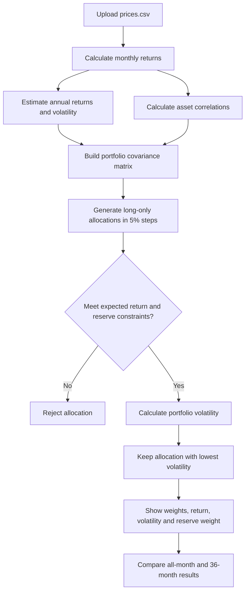

## Lab 15 — Portfolio Optimization and Stability Analysis

### Current Portfolio Selection — Original Estimates

After restoring VT's expected return to its original estimate, the optimizer returned the following allocation:

| Asset | Portfolio Weight |
|---|---:|
| SGOV | 65.00% |
| IEF | 0.00% |
| AGG | 0.00% |
| VT | 35.00% |

**Portfolio Results:**
- Expected Return: 6.58%
- Volatility: 5.29%
- Reserve-Eligible Weight: 65.00%

The allocation satisfies the 6.5% expected return objective and the minimum 3% reserve requirement.

### As-Loaded Portfolio — All Historical Months

The as-loaded portfolio produced the same allocation:

| Asset | Portfolio Weight |
|---|---:|
| SGOV | 65.00% |
| IEF | 0.00% |
| AGG | 0.00% |
| VT | 35.00% |

**Portfolio Results:**
- Expected Return: 6.58%
- Volatility: 5.29%
- Reserve-Eligible Weight: 65.00%

The current selection matches the as-loaded portfolio because the expected return estimates were restored to their original values. The largest allocation change between these two selections is 0 percentage points.

### Historical Stability Test — Last 36 Months

Using the last 36 months of historical returns, the optimizer produced a different allocation:

| Asset | Portfolio Weight |
|---|---:|
| SGOV | 85.00% |
| IEF | 0.00% |
| AGG | 0.00% |
| VT | 15.00% |

**Portfolio Results:**
- Expected Return: 6.81%
- Volatility: 1.79%
- Reserve-Eligible Weight: 85.00%

### Comparison of Estimation Windows

| Measure | All 60 Months | Last 36 Months |
|---|---:|---:|
| SGOV | 65.00% | 85.00% |
| IEF | 0.00% | 0.00% |
| AGG | 0.00% | 0.00% |
| VT | 35.00% | 15.00% |
| Expected Return | 6.58% | 6.81% |
| Volatility | 5.29% | 1.79% |
| Reserve-Eligible Weight | 65.00% | 85.00% |

**Largest Allocation Change: 20 percentage points.**

The shorter estimation period increased the recommended SGOV allocation by 20 percentage points while decreasing VT by the same amount. Estimated volatility decreased by 3.50 percentage points, and expected return increased by 0.23 percentage points.

### Estimation Risk

Estimation risk occurs when portfolio decisions rely on uncertain estimates of future returns, volatility, and correlations. Even relatively small differences in estimated inputs can significantly change an optimized portfolio.

The 20-percentage-point allocation shift demonstrates the sensitivity of portfolio optimization to the historical estimation period. The lower estimated volatility during the most recent 36 months does not guarantee that the portfolio will experience similarly low risk in the future.

### Investment Decision

**Decision: Pilot, Not Adopt.**

I would pilot the optimized portfolio rather than adopt it immediately. Although both historical estimation windows produced portfolios satisfying the stated return objective and reserve requirement, the recommended allocations differed significantly.

Before adopting the allocation, I would verify the reliability of the historical estimates, conduct additional sensitivity testing, and confirm that the investment strategy satisfies all Project 2 mandate constraints.

### Independent Stress-Test Proposal

A useful additional sensitivity test would be to reduce VT's expected annual return by one percentage point while holding the other assumptions constant.

This would provide further evidence about whether the allocation is stable when a single expected return estimate changes. The result should be recorded after the test is performed.

### Reflection

The lowest-risk portfolio changed because the optimizer uses estimated returns, volatility, and correlations to identify the minimum-risk allocation satisfying the investment objective and constraints.

The difference between the 60-month and 36-month results demonstrates why historical optimization should support, rather than replace, investment judgment.
### Partner Challenge

**Challenge:** My review partner questioned VT's estimated annual return of 11.90% and challenged me to lower it to 10.90%, keeping the 6.5% return objective and 3% reserve requirement unchanged.

**Original portfolio:** 65% SGOV, 0% IEF, 0% AGG, and 35% VT. Expected return was 6.58%, volatility was 5.29%, and reserve-eligible weight was 65%.

**Stressed portfolio:** 60% SGOV, 0% IEF, 0% AGG, and 40% VT. Expected return was 6.59%, volatility was 6.03%, and reserve-eligible weight was 60%.

**Largest allocation change:** 5 percentage points.

**My response:** The optimizer increased VT's allocation by five percentage points despite its lower expected return because it needed additional equity exposure to satisfy the 6.5% objective. This increased estimated volatility and reinforced my decision to pilot the allocation rather than adopt it without further sensitivity testing.

**Conclusion:** Both portfolios meet the return and reserve requirements, but the allocation is sensitive to the expected equity return assumption. This illustrates estimation risk and the importance of testing investment assumptions before making allocation decisions.

## Portfolio Engine Flowchart

The following diagram shows how my Lab 15 portfolio engine estimates risk and searches for the lowest-risk feasible allocation.

